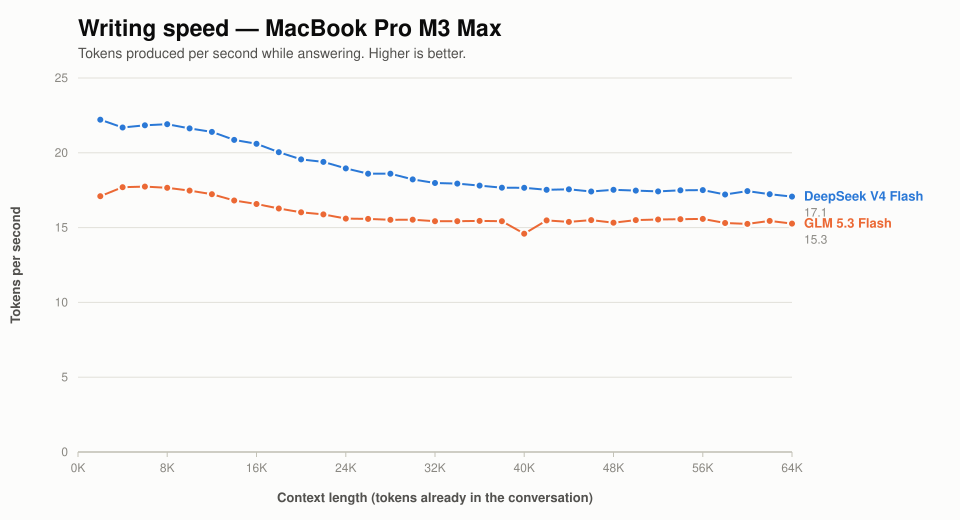
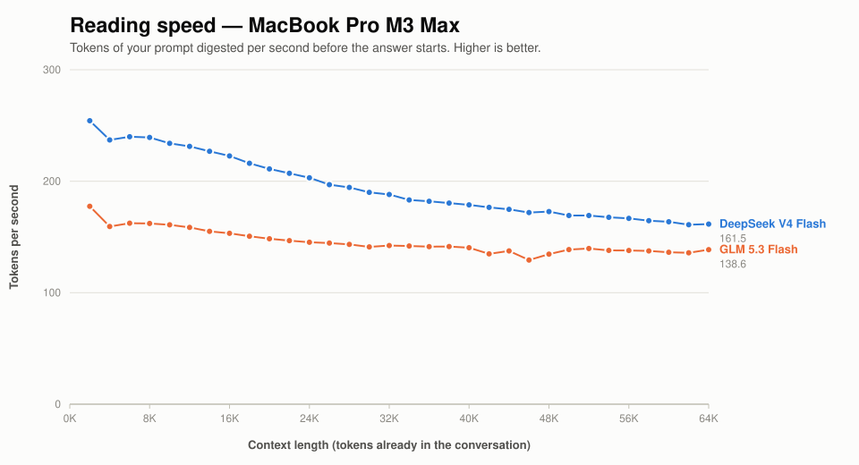
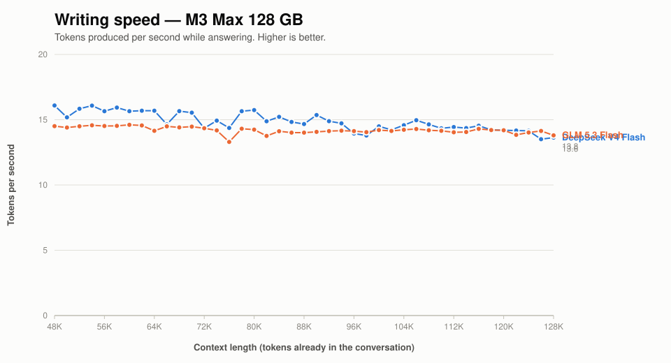
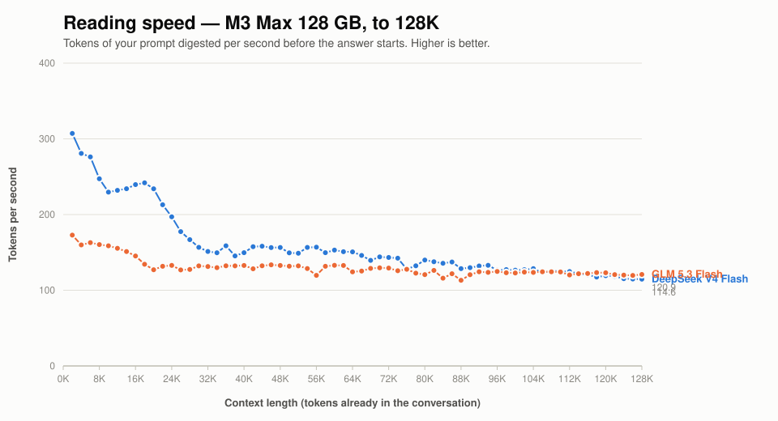
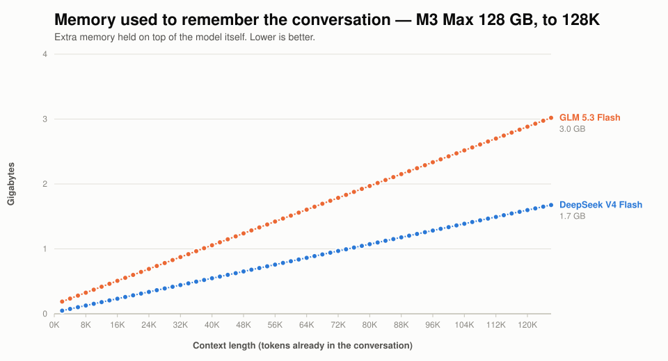

# DeepSeek V4 Flash vs GLM 5.3 Flash on a MacBook Pro M3 Max

[Performance guide](PERFORMANCE.md) | [Models](MODELS.md) | [README](../README.md)

Both models fit on a 128 GB M3 Max at their smallest quantisation. This
compares how fast each one actually is, measured on the same laptop on the
same afternoon.

**Short answer: DeepSeek is faster everywhere measured here — 12-30% on
writing and 17-48% on reading — and its lead narrows as the conversation
grows.** GLM is the steadier of the two throughout, and uses about twice the
memory to hold the conversation.

If the model has to share the machine with anything substantial, see
[SSD streaming](M3_MAX_STREAMING.md), which measures what a 70 GiB weight
budget costs. The two answers are different: DeepSeek streams well, GLM
does not stream at all.

## The numbers

Two speeds matter, and they are not the same thing:

- **Reading (prefill)** — how fast the model gets through what you have already written,
  before it starts replying. You wait for this once per message.
- **Writing (decode)** — how fast words appear in the reply. You watch this happen.

| Conversation so far | DeepSeek reads | DeepSeek writes | GLM reads | GLM writes |
| --- | ---: | ---: | ---: | ---: |
| 2,000 words | 254/s | 22.2/s | 178/s | 17.1/s |
| 8,000 | 239/s | 21.9/s | 162/s | 17.7/s |
| 16,000 | 223/s | 20.6/s | 153/s | 16.6/s |
| 32,000 | 188/s | 18.0/s | 142/s | 15.4/s |
| 49,000 | 173/s | 17.5/s | 135/s | 15.3/s |
| 65,000 | 162/s | 17.1/s | 139/s | 15.3/s |

Everything is in tokens per second; a token is roughly ¾ of a word.





## What the shape tells you

**DeepSeek starts further ahead than it finishes.** Its reading lead falls from
48% at 8,000 tokens to 17% at 65,000; its writing lead from 30% to 12%. DeepSeek
loses about a quarter of its writing speed as the conversation grows from 2,000
to 65,000 tokens; GLM loses about a ninth.

The two curves converge but do not meet within this range. See
[very long conversations](#very-long-conversations) below — with the caveat
noted there that those measurements are older than these.

**GLM is the more predictable of the two.** Across the long-conversation range
its speed varies by well under a percent between repeat runs. DeepSeek varies a
little more. Neither wobbles enough to notice while using them.

## Very long conversations

> **These figures are older than the rest of this page.** They were taken on
> build `6289c51` under macOS 26.6.1; everything above was re-measured on
> `058e5a4` under macOS 27.0.1, which reads 6% and writes 10% faster. The 128K
> sweeps were not re-run, so **do not compare the two tables directly** — the
> crossover below may sit at a different context length on the current build.
> Rerunning them takes about 50 minutes; see `speed-bench/queue_all.sh`.

Pushing both models to 128,000 tokens — twice the range above — changed the
answer on that build. DeepSeek's lead did not merely shrink; it disappeared.

| Conversation so far | DeepSeek writes | GLM writes | DeepSeek reads | GLM reads |
| --- | ---: | ---: | ---: | ---: |
| 49,000 | 16.1/s | 14.5/s | 157/s | 133/s |
| 65,000 | 15.7/s | 14.2/s | 151/s | 124/s |
| 82,000 | 15.7/s | 14.2/s | 140/s | 121/s |
| 98,000 | 13.9/s | 14.1/s | 127/s | 125/s |
| 115,000 | 14.4/s | 14.0/s | 125/s | 120/s |
| 131,000 | 13.6/s | **13.8/s** | 115/s | **121/s** |





These two charts start at 48,000 tokens rather than zero. The long sweeps were
a single pass each, so below that they are still measuring the laptop warming
up — see [reproducing this](#reproducing-this).

**Writing speed reaches parity somewhere between 82,000 and 98,000 tokens.**
DeepSeek holds a steady ~10.5% lead up to 82,000, and from 98,000 onward the
two are indistinguishable.

**Reading speed actually crosses over.** From 65,000 to 131,000 tokens
DeepSeek's reading speed falls 24%; GLM's falls under 3%. By 131,000 tokens GLM
is the faster reader.

The reason is structural. Both models use sparse attention, which scans what
has already been said to decide what is worth attending to, and that scan grows
with the conversation. DeepSeek does it on all 43 of its layers; GLM does it on
12, using a cheaper recurrent mechanism for the other 34. At short context the
difference is invisible; by 128,000 tokens it decides the ranking.

Measured over the whole range past 65,000 tokens, GLM drifts by 0.04 tokens/s
per 16,000 tokens of context — flat within measurement error — against
DeepSeek's 0.35. GLM is also the steadier of the two out there, varying about
a third as much between measurements.

**If you work in very long conversations, that reverses the recommendation the
shorter benchmark would give you.**

## Memory for the conversation

Separate from the model itself, each running conversation holds a growing block
of memory. This is what eventually limits how long a conversation can get.



| Conversation so far | DeepSeek | GLM |
| --- | ---: | ---: |
| 16,000 | 0.23 GB | 0.51 GB |
| 32,000 | 0.44 GB | 0.87 GB |
| 49,000 | 0.65 GB | 1.24 GB |
| 65,000 | 0.86 GB | 1.60 GB |
| 98,000 | 1.28 GB | 2.33 GB |
| 115,000 | 1.49 GB | 2.70 GB |

**GLM uses about 86% more**, and the growth is a straight line for both out to
128,000 tokens. That is worth knowing on a machine where the model already
occupies 90 GB of 128: GLM's larger appetite arrives on top of a larger model.

A useful way to put it: **GLM reaches any given memory footprint at roughly
half the conversation length.** GLM at 65,000 tokens already holds more than
DeepSeek does at 115,000.

### Does it actually fit?

Sampling system memory every 15 seconds through both 128,000-token runs:

| | DeepSeek | GLM |
| --- | ---: | ---: |
| Peak pinned memory | 91.6 GB | **99.3 GB** |
| Free memory, low point | 0.15 GB | 0.30 GB |
| Swap used | flat, ~780 MB | flat, ~752 MB |

**Both fit, with no paging at any point.** Swap did not grow by a single
megabyte across an hour of running, which is the measurement that matters —
free memory dropping near zero is normal and harmless when the shortfall is
reclaimable disk cache.

GLM at 128,000 tokens is the tightest configuration tested: 99.3 GB pinned on a
128 GB machine, with free memory down to 0.3 GB. It works, but there is not
much room left for anything else, and this is with nothing else running. Raw
samples in `speed-bench/m3_max_128k_memory.csv`.

One caveat on reading those: in `vm_stat`, "wired" and "anonymous" pages
overlap — a wired anonymous page is counted in both — so adding them
double-counts and will suggest you are out of memory when you are not. Watch
pinned memory and swap.

## The thing that surprised us most

**None of these differences matter as much as what else your laptop is doing.**

Every wrong number we produced during this exercise — and there were many —
came from the machine, not the models. In one afternoon we hit:

| What happened | What it looked like |
| --- | --- |
| Another app held ~40 GB, so the model could not stay in memory | Speed fell steadily with conversation length, 28 → 10/s |
| A virtual machine was busy in the background | Every speed roughly halved, uniformly |
| The laptop got hot after ~2 minutes of full load | Speed fell ~45% then settled |
| A previous run's memory had not been released yet | Next model started 18% slow, or failed outright |
| The benchmark's own memory limit was exceeded | One model silently penalised beyond 39,000 tokens |

Each of these looked exactly like "one model is slower than the other" until
it was chased down. The model difference we ended up measuring, 10-27%, is
**smaller than several of these effects.**

The practical version: if you want to compare two models on a laptop, close
everything else first, and be more suspicious of a surprising result than of a
boring one.

## Heat

Sustained load costs this machine about 45% of its speed. Starting from cold it
writes at ~30 tokens/s, drops as it heats, and settles at ~16 after roughly ten
minutes. It stays there indefinitely.

Both numbers are true, and which one you get depends on how long you have been
working. The tables above are all **sustained** figures, because that is the
one a laptop converges to regardless of how it started, and it is what a long
working session actually feels like. A cold machine is faster than anything
here for the first couple of minutes.

## Reproducing this

```sh
export DS4_BENCH_SNAPSHOT_MAX_BYTES=4294967296   # see note below
./ds4-bench -m gguf/DeepSeek-V4-Flash-IQ2XXS-w2Q2K-AProjQ8-SExpQ8-OutQ8-chat-v2-imatrix-0731.gguf \
  --prompt-file speed-bench/promessi_sposi.txt \
  --ctx-start 2048 --ctx-max 65536 --step-incr 2048 --gen-tokens 128 \
  --csv m3_max_ds4f_q2.csv
```

Run each model's sweep **twice back to back and use the second**. The first
brings the machine to its sustained operating point; the second measures it
there. Otherwise you measure how cold the laptop happened to be.

The tables above are pass 2 alone. (Figures published here before 2026-10-02
were the mean of both passes, which quietly folded pass 1's warm-up and its
cache-churn dips into the result; pass 2 is the sustained number this section
argues for.)

Raise `DS4_BENCH_SNAPSHOT_MAX_BYTES`. The 1 GiB default is fine for a single
model, but GLM's per-conversation state crosses it near 39,000 tokens while
DeepSeek's does not until ~64,000. Past the limit the harness replays the
conversation between measurements instead of restoring a snapshot, which takes
roughly six times as long per step and heats the machine — penalising GLM over
exactly the range where the two are being compared. Left at the default, GLM
appears to lose 6% over a stretch where it is in fact flat.

Charts: `python3 speed-bench/plot_comparison.py --run "NAME=FILE.csv" ...`

## Exactly what was measured

There are two different DeepSeek V4 Flash checkpoints and several
quantisations of each, so filenames are important to check.

| | DeepSeek V4 Flash | GLM 5.3 Flash |
| --- | --- | --- |
| File | `DeepSeek-V4-Flash-IQ2XXS-w2Q2K-AProjQ8-SExpQ8-OutQ8-chat-v2-imatrix-0731.gguf` | `GLM-5.3-Flash-Q2.gguf` |
| Size | 86,720,111,488 bytes (80.76 GiB) | 96,505,816,384 bytes (89.88 GiB) |
| Architecture | `deepseek4`, 43 layers, 256 experts, 6 used | `glm5-next`, 46 layers, 288 experts, 8 used |
| Experts stored as | IQ2_XXS gate/up, Q2_K down | IQ2_XXS gate/up, Q2_K down |
| Source revision | — | `84c6a6aa9497188e15a635ba793b0f95a79b1033` |

Host: MacBook Pro M3 Max, 40 GPU cores, 128 GiB, macOS 27.0.1, Metal.
Build: `058e5a4` (upstream `main` at `6289c51` plus 23 commits), Apple clang.
Measured 2026-10-02. The 2K-64K tables and charts are from this build; the
128,000-token section is from `6289c51` under macOS 26.6.1 and is marked as
such.
Prompt: `speed-bench/promessi_sposi.txt`. 128 tokens generated per frontier.

The 128,000-token runs used `--ctx-max 131072` and an 8 GiB snapshot budget, a
single pass each. A sweep that long takes 24 minutes, so it is already at its
sustained operating point well before it reaches 65,000 tokens — the region it
was run to measure. Its early frontiers are *not* comparable with the tables
above and should be ignored; those come from the two-pass sweeps.

Raw data in `speed-bench/`: `m3_max_*_pass1.csv` and `_pass2.csv` (2K-64K,
both passes published so repeatability is visible rather than asserted),
`m3_max_*_128k.csv` (2K-128K), and `m3_max_128k_memory.csv` (memory sampled
every 15 seconds through both long runs).

## What this does not tell you

- **Which model is better.** This is speed only. A 10-27% difference is small
  next to any difference in answer quality, and quality is not measured here.
  `gguf-tools/quality-testing/` has fixtures for that.
- **How they behave past 128,000 tokens.** Both accept longer conversations
  than that, but GLM was already using 99.3 GB of this machine's 128 GB at 128,000,
  so the ceiling here is memory rather than patience.
- **How they behave on your machine.** A 30-core M3 Max has less memory
  bandwidth than the 40-core part measured here, and writing speed depends
  almost entirely on memory bandwidth.
- **Anything about GLM's built-in draft mode.** That is a large enough topic
  to have its own page: [GLM 5.3 MTP](M3_MAX_GLM_MTP.md).
- **What it costs to leave memory free.** Both models were fully resident here.
  [SSD streaming](M3_MAX_STREAMING.md) measures a 70 GiB weight budget instead.
