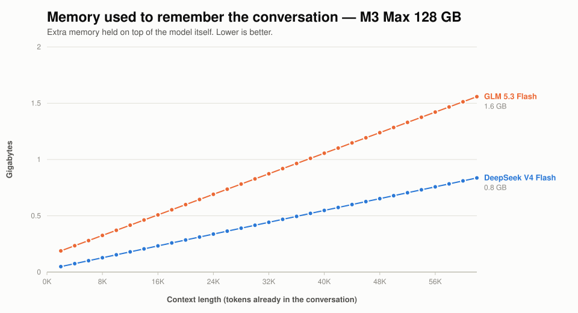

# DeepSeek V4 Flash vs GLM 5.3 Flash on a MacBook Pro M3 Max

[Performance guide](PERFORMANCE.md) | [Models](MODELS.md) | [README](../README.md)

Both models fit on a 128 GB M3 Max at their smallest quantisation. This
compares how fast each one actually is, measured on the same laptop on the
same afternoon.

**Short answer: DeepSeek is faster, by 10-27% depending on the length of the
conversation.** GLM is steadier, and holds up better as the conversation grows.
Neither difference is large enough to pick a model on speed alone.

## The numbers

Two speeds matter, and they are not the same thing:

- **Reading** — how fast the model gets through what you have already written,
  before it starts replying. You wait for this once per message.
- **Writing** — how fast words appear in the reply. You watch this happen.

| Conversation so far | DeepSeek reads | DeepSeek writes | GLM reads | GLM writes |
| --- | ---: | ---: | ---: | ---: |
| 2,000 words | 251/s | 21.5/s | 173/s | 16.9/s |
| 8,000 | 233/s | 21.1/s | 160/s | 17.4/s |
| 16,000 | 212/s | 18.8/s | 149/s | 16.0/s |
| 32,000 | 182/s | 17.1/s | 138/s | 14.9/s |
| 49,000 | 167/s | 16.6/s | 138/s | 14.7/s |
| 65,000 | 156/s | 16.3/s | 135/s | 14.8/s |

Everything is in tokens per second; a token is roughly ¾ of a word.


## What the shape tells you

**DeepSeek starts further ahead than it finishes.** It is 27% faster on a short
conversation and only 10% faster on a very long one. DeepSeek loses about a
quarter of its writing speed as the conversation grows from 2,000 to 65,000
tokens; GLM loses about an eighth.

The two curves are converging. Whether they would ever cross is not something
this data answers — at 65,000 tokens DeepSeek is still ahead, and the models
accept far longer conversations than that. Extrapolating two converging lines
past the end of the measurements is how people talk themselves into conclusions
the data does not support, so: unknown, and testable if it matters to you.

**GLM is the more predictable of the two.** Across the long-conversation range
its speed varies by well under a percent between repeat runs. DeepSeek varies a
little more. Neither wobbles enough to notice while using them.

## Memory for the conversation

Separate from the model itself, each running conversation holds a growing block
of memory. This is what eventually limits how long a conversation can get.



| Conversation so far | DeepSeek | GLM |
| --- | ---: | ---: |
| 16,000 | 0.23 GB | 0.51 GB |
| 32,000 | 0.44 GB | 0.87 GB |
| 49,000 | 0.65 GB | 1.24 GB |
| 63,000 | 0.84 GB | 1.56 GB |

**GLM uses about 86% more.** That is worth knowing on a machine where the model
already occupies 90 GB of 128: GLM's larger appetite arrives on top of a larger
model. At the 200,000-token context the server now defaults to, straight-line
extrapolation puts GLM near 5 GB and DeepSeek near 2.6 GB — with the same
caveat about extrapolation as above.

## The thing that surprised us most

**None of these differences matter as much as what else your laptop is doing.**

Every wrong number we produced during this exercise — and there were many —
came from the machine, not the models. In one afternoon we hit:

| What happened | What it looked like |
| --- | --- |
| Another app held ~40 GB, so the model could not stay in memory | Speed fell steadily with conversation length, 28 → 10/s |
| A virtual machine was busy in the background | Every speed roughly halved, uniformly |
| The laptop got hot after ~2 minutes of full load | Speed fell ~45% then settled |
| A previous run's memory had not been released yet | Next model started 18% slow, or failed outright |
| The benchmark's own memory limit was exceeded | One model silently penalised beyond 39,000 tokens |

Each of these looked exactly like "one model is slower than the other" until
it was chased down. The model difference we ended up measuring, 10-27%, is
**smaller than several of these effects.**

The practical version: if you want to compare two models on a laptop, close
everything else first, and be more suspicious of a surprising result than of a
boring one.

## Heat

Sustained load costs this machine about 45% of its speed. Starting from cold it
writes at ~30 tokens/s, drops as it heats, and settles at ~16 after roughly ten
minutes. It stays there indefinitely.

Both numbers are true, and which one you get depends on how long you have been
working. The tables above are all **sustained** figures, because that is the
one a laptop converges to regardless of how it started, and it is what a long
working session actually feels like. A cold machine is faster than anything
here for the first couple of minutes.

## Reproducing this

```sh
export DS4_BENCH_SNAPSHOT_MAX_BYTES=4294967296   # see note below
./ds4-bench -m gguf/DeepSeek-V4-Flash-IQ2XXS-w2Q2K-AProjQ8-SExpQ8-OutQ8-chat-v2-imatrix-0731.gguf \
  --prompt-file speed-bench/promessi_sposi.txt \
  --ctx-start 2048 --ctx-max 65536 --step-incr 2048 --gen-tokens 128 \
  --csv m3_max_ds4f_q2.csv
```

Run each model's sweep **twice back to back and use the second**. The first
brings the machine to its sustained operating point; the second measures it
there. Otherwise you measure how cold the laptop happened to be.

Raise `DS4_BENCH_SNAPSHOT_MAX_BYTES`. The 1 GiB default is fine for a single
model, but GLM's per-conversation state crosses it near 39,000 tokens while
DeepSeek's does not until ~64,000. Past the limit the harness replays the
conversation between measurements instead of restoring a snapshot, which takes
roughly six times as long per step and heats the machine — penalising GLM over
exactly the range where the two are being compared. Left at the default, GLM
appears to lose 6% over a stretch where it is in fact flat.

Charts: `python3 speed-bench/plot_comparison.py --run "NAME=FILE.csv" ...`

## Exactly what was measured

There are two different DeepSeek V4 Flash checkpoints and several
quantisations of each, so filenames alone are ambiguous.

| | DeepSeek V4 Flash | GLM 5.3 Flash |
| --- | --- | --- |
| File | `DeepSeek-V4-Flash-IQ2XXS-w2Q2K-AProjQ8-SExpQ8-OutQ8-chat-v2-imatrix-0731.gguf` | `GLM-5.3-Flash-Q2.gguf` |
| Size | 86,720,111,488 bytes (80.76 GiB) | 96,505,816,384 bytes (89.88 GiB) |
| Architecture | `deepseek4`, 43 layers, 256 experts, 6 used | `glm5-next`, 46 layers, 288 experts, 8 used |
| Experts stored as | IQ2_XXS gate/up, Q2_K down | IQ2_XXS gate/up, Q2_K down |
| Source revision | — | `84c6a6aa9497188e15a635ba793b0f95a79b1033` |

Host: MacBook Pro M3 Max, 40 GPU cores, 128 GiB, macOS 26.6.1, Metal.
Build: upstream `main` at `6289c51`, Apple clang 21.0.0.
Prompt: `speed-bench/promessi_sposi.txt`. 128 tokens generated per frontier.

Raw data: `speed-bench/m3_max_*_pass1.csv` and `_pass2.csv` — both passes are
published so the repeatability is visible rather than asserted.

## What this does not tell you

- **Which model is better.** This is speed only. A 10-27% difference is small
  next to any difference in answer quality, and quality is not measured here.
  `gguf-tools/quality-testing/` has fixtures for that.
- **How they behave past 65,000 tokens.** Both accept much longer conversations.
- **How they behave on your machine.** A 30-core M3 Max has less memory
  bandwidth than the 40-core part measured here, and writing speed depends
  almost entirely on memory bandwidth.
- **Anything about GLM's built-in draft mode.** That is a large enough topic
  to have its own page: [GLM 5.3 MTP](M3_MAX_GLM_MTP.md).
