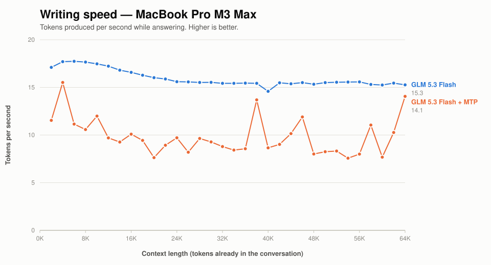
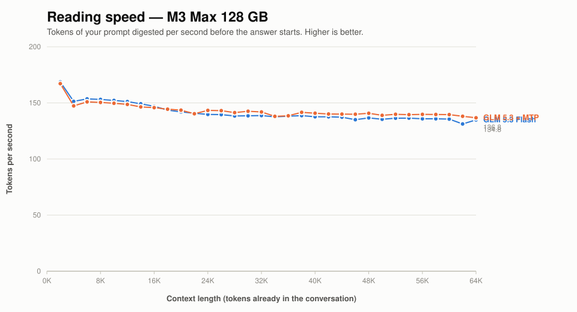

# GLM 5.3 Flash's built-in draft mode on a MacBook Pro M3 Max

[Speculative decoding](SPECULATIVE_DECODING.md) | [DS4 vs GLM](M3_MAX_DS4_VS_GLM.md) | [README](../README.md)

GLM 5.3 Flash ships with a small extra block that guesses the next word before
the main model has worked it out. If the guess is right you get two words for
roughly the price of one; if it is wrong you have paid for the guess and still
need the real answer. It is off by default, and `--mtp` turns it on.

**Short answer: on this laptop, with ordinary prose, it makes GLM about 13%
slower rather than faster.** It is not broken — it is being asked to guess text
it cannot guess well enough for the arithmetic to work.

## What it costs

| | Writing speed | vs plain |
| --- | ---: | ---: |
| Plain decode (no `--mtp`) | 16.4/s | — |
| `--mtp`, default settings | 14.3/s | **−13%** |
| `--mtp --mtp-margin 1` | 9.4/s | −43% |
| `--mtp --mtp-margin 0` | 12.7/s | −23% |

Measured over 2,000-8,000 tokens of context. Over the full sweep to 65,000
tokens the default setting averages 9.4/s against plain decode's 14.9/s.



The gap is wide and it widens with the conversation. It is also visibly
*ragged* in a way the plain line is not — that jaggedness is the point of this
page, and the next two sections are about it.

Reading speed is unaffected, as it should be — the draft block only
participates in writing:



Memory is unaffected too. The per-conversation cache is **byte-identical**
with and without `--mtp` at every context measured; the draft block reuses the
same cache rather than keeping its own.

## Why: the arithmetic of guessing

Turning on the timing counters (`--mtp-timing`) shows what each cycle costs.
Across 347 cycles:

| | Frequency | Cost | Per word |
| --- | ---: | ---: | ---: |
| Guess was right | 46% | 93 ms → 2 words | **46 ms** |
| Guess was wrong | 54% | 147 ms → 1 word | **147 ms** |
| *(plain decode, for comparison)* | | ~65 ms → 1 word | ~65 ms |

**A correct guess saves about 19 ms. A wrong guess costs about 82 ms.** One
miss cancels out four hits.

That ratio sets the bar: the guesses need to be right **77-91% of the time**
before the feature breaks even, depending on where plain decode actually sits.
It is achieving **46%**. It is not marginally short — it would still lose at
70%.

Those cycle timings predict 9.9 words/s. The benchmark measured 9.4. Close
enough to say the mechanism is understood rather than guessed at.

## It is wildly inconsistent

This matters more than the average, and an average hides it completely.

Over the long-conversation range, plain GLM's speed varies by 2% between
measurements. With `--mtp` it varies by **69%** — from 7.4/s to 13.8/s.

The variation is not random. Repeat runs reproduce the same peaks and troughs
at the same points in the text, because it depends on how guessable that
particular passage is. At one measurement point MTP reached 18.0/s against
plain decode's 16.4/s — a genuine win, in the middle of an overall loss.

So "MTP is 13% slower" is true and close to useless. It is sometimes much
slower and occasionally faster, depending entirely on what is being written.

## The knobs, and what they do not fix

**Draft width is not adjustable.** GLM 5.3 declares one draft head
(`n_nextn_predict = 1`), and the engine hardcodes a width of 2 for the GLM
family — one real word plus one guess. That is already the cheapest possible
configuration. `--mtp-draft` applies only to an external support model, not to
this built-in block.

**The confidence margin does not rescue it.** `--mtp-margin` decides how sure
the draft block must be before its guess is taken on the fast path. Neither
lowering it to 1 nor disabling the gate entirely (0) beat the default of 3, and
both were worse. Whatever the right setting is, it is not one that turns a
losing trade into a winning one here.

## When it would be worth turning on

The benchmark continues 19th-century Italian prose. That is close to a
worst case for a small draft head: fluent, varied, and not formulaic.

The mechanism rewards *predictable* text. Boilerplate code, structured output,
repeated formatting, long quotations, anything with strong local regularity —
those plausibly reach the 80%+ acceptance the arithmetic needs, and the same
feature that loses 13% here would win. Recorded runs on other machines show
GLM going from 34.5 to 42.0 words/s with this enabled, which is what winning
looks like.

So the honest guidance is: **try it on your own workload and measure, because
the answer depends on what you write, not on the model or the machine.**

```sh
# your workload, with and without
./ds4-bench -m gguf/GLM-5.3-Flash-Q2.gguf --prompt-file YOUR_TEXT.txt \
  --ctx-start 2048 --ctx-max 8192 --step-incr 2048 --gen-tokens 128 --csv plain.csv
./ds4-bench -m gguf/GLM-5.3-Flash-Q2.gguf --prompt-file YOUR_TEXT.txt \
  --ctx-start 2048 --ctx-max 8192 --step-incr 2048 --gen-tokens 128 --mtp --csv mtp.csv

# and to see the acceptance rate directly
./ds4-bench ... --mtp-timing 2>&1 | grep -c ACCEPT
```

If acceptance is comfortably above 80%, turn it on. Below 70%, do not.

## Caveats

- **One machine, one workload.** Nothing here says MTP is a bad feature; it
  says this text is hard to guess. A different corpus could reverse it.
- **One run per margin setting.** Given how much this workload varies, the
  ordering between margin values is not reliable. That all three lost to plain
  decode is the robust part.
- **The benchmark's decode probe is synthetic** — a fixed greedy continuation
  with end-of-text suppressed, not a real conversation.
- Writing speed on this laptop drops ~45% once it is hot; see the
  [thermal note](M3_MAX_DS4_VS_GLM.md#heat). All figures here are sustained.

## Exactly what was measured

Model: `GLM-5.3-Flash-Q2.gguf`, 96,505,816,384 bytes, source revision
`84c6a6aa9497188e15a635ba793b0f95a79b1033`.
Host: MacBook Pro M3 Max, 40 GPU cores, 128 GiB, macOS 26.6.1, Metal.
Build: upstream `main` at `6289c51` plus `--mtp`/`--mtp-margin` support in
`ds4-bench`. `DS4_BENCH_SNAPSHOT_MAX_BYTES=4294967296`.

Raw data in `speed-bench/`: `m3_max_glm53f_q2_mtp_pass1.csv` and `_pass2.csv`
(full sweeps), `m3_max_glm53f_q2_mtp_margin_{default,0,1}.csv` (margin sweep),
and `m3_max_glm53f_q2_mtp_timing.log` (347 logged cycles, the source of the
acceptance figure). Plain GLM for comparison is
`m3_max_glm53f_q2_pass2.csv`; charts are drawn with
`speed-bench/plot_comparison.py`.

Both models' plain-decode comparison, including the long-context behaviour that
this page does not cover, is in [DeepSeek vs GLM](M3_MAX_DS4_VS_GLM.md).
