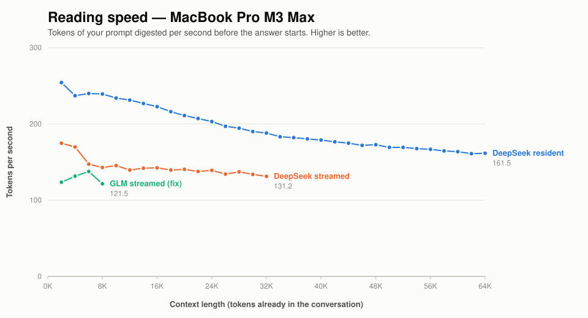
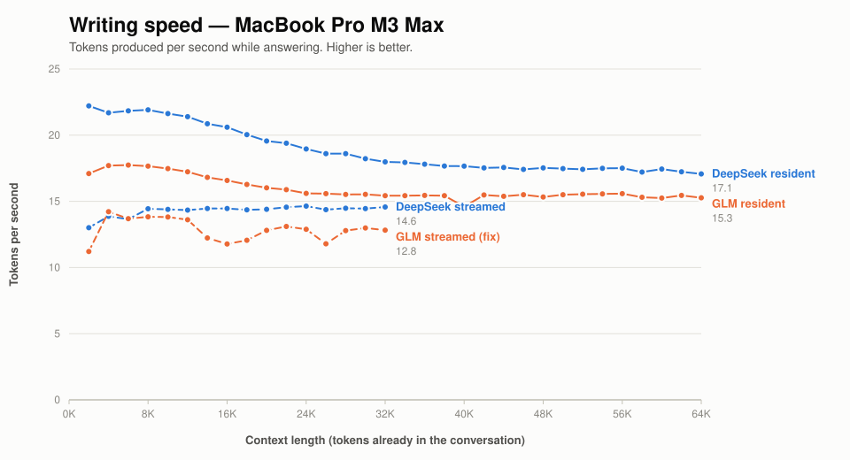

# Keeping your RAM back: SSD streaming on a MacBook Pro M3 Max

[Models larger than RAM](SSD_STREAMING.md) | [Model comparison](M3_MAX_DS4_VS_GLM.md) | [README](../README.md)

Both DeepSeek V4 Flash and GLM 5.3 Flash fit on a 128 GB M3 Max at their
smallest quantisation — but only just, and with nothing much left for the rest
of your machine. This page measures what happens when you ask for less: an
expert cache capped so that roughly 70 GiB of weights stay resident and the
remainder is read from the GGUF on demand.

**Short answer: DeepSeek streams well today; GLM streams only with a fix that
is not yet merged.** DeepSeek gives up about a third of its reading speed and
almost none of its writing speed at long context, at the cost of a one-second
pause before each reply. Upstream GLM, asked for the same budget, declines it:
it maps all 90 GiB of its experts anyway and plans 106 GiB in total, which is
more memory than running it resident. With the five-commit fix on
`fix/glm53-metal-iq2-q2k-stream-cache`, GLM keeps to a 73 GiB plan and gives up
about a quarter of its reading speed and a fifth of its writing speed, with
replies starting in under 0.2 seconds once the first prompt is in.

## What was asked for

```sh
./ds4-bench -m MODEL.gguf --ssd-streaming --ssd-streaming-cache-experts 62GB \
  --prompt-file speed-bench/promessi_sposi.txt \
  --ctx-start 2048 --ctx-max 32768 --step-incr 2048 --gen-tokens 128 --csv OUT.csv
```

62 GiB was chosen because both models carry about 8.2 GiB of non-routed weights
that stay resident whatever the cache setting — attention projections, the token
embedding, the output head, shared experts. 62 + 8.2 ≈ 70 GiB, leaving nearly
60 GB of a 128 GB machine for everything else.

DeepSeek plans exactly that:

    resident model 8.20 GiB + expert cache 58.62 GiB + prefill reserve 3.38 GiB
    = 71.05 GiB planned

## DeepSeek: a real trade, and a reasonable one

Pass 2 of each configuration, same build, same machine, same night:

| Conversation so far | resident | streamed | reading | writing |
| --- | ---: | ---: | ---: | ---: |
| 2,000 | 254/22.2 | 175/13.9 | −31% | −38% |
| 8,000 | 239/21.9 | 143/16.9 | −40% | −23% |
| 16,000 | 223/20.6 | 142/16.8 | −36% | −18% |
| 24,000 | 203/18.9 | 139/17.0 | −32% | −10% |
| 32,000 | 188/18.0 | 131/17.0 | −30% | **−5%** |

Reading and writing speed in tokens per second; a token is roughly ¾ of a word.





Colour is the model and dashes mean streamed. The resident sweeps run to
64,000 tokens, the streamed ones to 32,000. GLM streamed is the fixed build
[described below](#glm-with-the-fix-the-budget-is-kept). Upstream GLM is left out
of the charts: with the budget ignored it maps the whole file, so it is not
streaming at all.

**The writing penalty disappears as the conversation grows** — 38% at 2,000
tokens, 5% at 32,000. Past about 24,000 tokens the two configurations write at
the same speed. At long context, attention over what has already been said
dominates the cost of each token, so the expert reads matter proportionally
less.

**The reading penalty does not.** It stays at 30–40% throughout, because prefill
touches far more experts per token than decode does: every token in the prompt
routes independently, so a 2,048-token chunk reaches most of the model while a
single decoded token reaches a handful of experts.

**The cost you actually feel is the first token.** Averaged over 16K–32K:

| | resident | streamed |
| --- | ---: | ---: |
| First token after a prompt | 42 ms | **1,311 ms** |
| Sustained writing | 19.1/s | 16.9/s |
| Reading | 203/s | 137/s |

A 31× increase. Sustained writing speed at long context is nearly identical, so
a streamed reply *reads* at almost the same rate once it starts — it just starts
about 1.3 seconds late, every time.

## GLM upstream: the budget is ignored

Given the same flags, upstream GLM 5.3 Flash reports this instead:

    GLM SSD streaming full resident layers: 0 (auto selected 0 layers)
    GLM SSD streaming request adjusted to fit memory: cache 8829 -> 1363 experts
    GLM SSD streaming decode map: global 89.87 GiB
    resident model 89.87 GiB + expert cache 8.98 GiB + prefill reserve 3.80 GiB
    = 105.99 GiB planned

The 62 GiB cache became 9 GiB, and the whole 89.87 GiB expert set was mapped as
a *global static decode map* instead. The plan is 106 GiB — about 35 GiB more
than DeepSeek's streamed plan, and more than GLM needs to run fully resident.

Its speeds are consequently close to its resident speeds, because the
configuration is close to resident:

| | GLM resident | GLM "streamed" |
| --- | ---: | ---: |
| Reading, mean 16K–32K | 146/s | 139/s |
| Writing, mean 16K–32K | 15.8/s | 15.9/s |
| First token | 55 ms | 886 ms |

**Read carelessly, that table says GLM streams better than DeepSeek. It does
not — GLM barely streams at all.** And the memory it asks for is not available:
sampling every 15 seconds through the run shows wired memory flapping between
24 GiB and 97 GiB as the kernel wires the map, gives up, and lets it fall back
to page cache, over and over. Swap was touched (167 MB) and the compressor
reached 16 GiB, squeezing two running VMs from 31 GiB resident down to 3 GiB.
The DeepSeek streamed run, by contrast, peaked at 77.9 GiB wired with 4.9 GiB of
compressor and 0.19 MB of swap.

### Why

Two upstream decisions combine.

**GLM 5.3 Q2's expert layout has no cache route on Metal.** Its routed experts
are IQ2_XXS gate/up with a Q2_K down projection and eight experts per token.
`glm_stream_selected_expert_cache_supported` refuses that layout on Apple unless
exactly six experts are used, because the only Metal kernel for an IQ2/Q2_K down
projection through the cache sums exactly six. DeepSeek V4 Flash has the same
layout with six experts, which is why it streams. For GLM, no layer counts as
streamed, so the static decode map has to cover every routed tensor: the whole
file.

**The static map wins whenever it fits, judged against total RAM.** On Metal,
`metal_graph_stream_decode_static_map_enabled()` (`ds4.c:19739`) returns `true`
unconditionally, so the GLM streaming path tries the global static map first and
falls back to per-layer streaming only if the map "does not fit"
(`ds4.c:68440-68465`). That fit check is against total RAM, not free RAM — so on
a 128 GiB machine a 90 GiB map always fits, and an explicit
`--ssd-streaming-cache-experts` is reduced to make room for it.

The second is a sensible heuristic for the case the feature was built for, where
the model is larger than RAM and mapping everything is the best available move.
It is the wrong question for "the model fits, but I want my memory back", which
is the case measured here.

### The fallback is worse

Where the static map is disabled, or does not fit, GLM takes a per-layer
fallback. That keeps to the budget (73 GiB planned) but maps each layer's whole
expert span from the GGUF on every token, and **never fills the cache it
budgeted** — the cache route is still refused.

| Upstream GLM, per-layer fallback | reading | writing | first token |
| --- | ---: | ---: | ---: |
| 128 GB Mac, 62 GiB cache | 162/s | 0.58/s | 2.0 s |
| Simulated 64 GB Mac, 28 GiB cache | 123/s | **0.03/s** | 32.7 s |

Both at a 2,048-token prompt. On the 128 GB machine, spare RAM holds much of
the file in page cache; with 64 GB locked away it cannot, and 32 tokens took
about 18 minutes.

An earlier version of this page reported 1.09/s for this regime and put it down
to a cold cache filling during its first 128 tokens. That was wrong: the cache
is never filled at all. Preloading it (`--ssd-streaming-preload-experts`) makes
no difference, because the seeder skips every layer for the same reason the
cache route is refused.

This matters beyond this page: **on a Mac where GLM 5.3 Q2 genuinely does not
fit, this fallback is what upstream does by default.**

## GLM with the fix: the budget is kept

`fix/glm53-metal-iq2-q2k-stream-cache` adds the missing Q2_K kernels for decode
and prefill through the cache, plus prefill scheduling to go with them. The
details are in [the PR description](../speed-bench/PR_glm53_metal_stream_cache.md).
With the same command, the plan becomes:

    GLM SSD streaming decode map: global 8.24 GiB
    resident model 8.24 GiB + expert cache 58.20 GiB + prefill reserve 3.80 GiB
    = 73.26 GiB planned

Wired memory peaked at 74.7 GiB during the 32K sweep, and no swap was added.

The same sweep as DeepSeek's, 2K–32K, one pass after a short 2K–4K warm-up run,
against GLM's resident pass 2 from the same machine:

| Conversation so far | resident | streamed | reading | writing |
| --- | ---: | ---: | ---: | ---: |
| 2,000 | 178/17.1 | 122/11.9 | −31% | −30% |
| 8,000 | 162/17.6 | 147/14.0 | −10% | −21% |
| 16,000 | 153/16.6 | 106/11.9 | −31% | −28% |
| 24,000 | 145/15.6 | 117/13.0 | −19% | −16% |
| 32,000 | 142/15.4 | 108/12.9 | −24% | **−16%** |

Writing is the steady rate, as in the DeepSeek table. Averaged over 16K–32K,
next to DeepSeek's figures from above:

| | GLM resident | GLM streamed | DeepSeek resident | DeepSeek streamed |
| --- | ---: | ---: | ---: | ---: |
| First token after a prompt | 55 ms | **171 ms** | 42 ms | **1,311 ms** |
| Sustained writing | 15.8/s | 12.7/s (−20%) | 19.1/s | 16.9/s (−12%) |
| Reading | 146/s | 110/s (−25%) | 203/s | 137/s (−33%) |

**GLM's penalties are milder on reading and harsher on writing than
DeepSeek's.** DeepSeek's writing penalty fades to 5% by 32,000 tokens; GLM's
levels off at about 16%. In absolute terms, streamed GLM reads and writes
slower than streamed DeepSeek throughout, just as it does resident.

**The first token is where the fixed GLM build clearly does better.** It
starts replying about 3× later than resident; DeepSeek streamed does so 31×
later. The likely reason is the fix's last commit, which serves large prefill
chunks through the cache and reads each layer's missing experts ahead, so
decoding starts from a warm cache. Upstream DeepSeek does not do that. The two
were built from different trees, though, so treat this as a lead rather than a
like-for-like result.

**One pass, so read the middle of the curve with care.** Reading dips to
105/s between 16,000 and 20,000 tokens and recovers to 117 by 24,000. That
looks like the expert-cache churn DeepSeek's first passes showed in the same
region (see [Reproducing this](#reproducing-this)), which is why its table
quotes pass 2. A second GLM pass has not been run. Over 2K–8K, this sweep
(122–147 reading) agrees with the first fixed-build sweep on 2026-10-03
(122–138). A later run that day measured 94–98, straight after a series of
back-to-back benchmarks that were themselves varying by up to 25%.

### A long prompt, and follow-up messages

Two shapes of use the sweep does not cover, both with the 62 GiB cache:

| | reading | writing | first token |
| --- | ---: | ---: | ---: |
| One 16,000-token prompt (two runs) | 111–112/s | 12.2–12.5/s | 0.16–0.17 s |
| 128-token follow-ups after a 2,000-token prompt | 36–51/s | 12.9–13.8/s | 0.11–0.12 s |

Each follow-up message takes 2.5–3.6 seconds to read in. Before the fix's
fourth commit it was about 36 seconds, because short chunks touched almost
every expert of every layer and faulted whole layers in from the GGUF.

### On a smaller Mac

A simulated 64 GB Mac (`--simulate-used-memory 64GB` locks 64 GB before the
model loads) with a 28 GiB cache, about what such a machine sizes for itself.
The plan is 39.2 GiB. Upstream is forced onto the per-layer fallback here, the
path it takes by default on a real 64 GB Mac:

| | reading at 2,000 | writing at 2,000 | first token | reading at 4,000 | writing at 4,000 |
| --- | ---: | ---: | ---: | ---: | ---: |
| upstream | 123/s | **0.03/s** | 32.7 s | not run | — |
| fixed (two runs) | 104–110/s | **7.3–7.4/s** | 0.8–1.3 s | 125–128/s | 9.0/s |

A single 16,000-token prompt on the fixed build reads at 96–98/s, writes at
6.7/s, and starts replying in 0.35–0.38 s. At 2,000 tokens the fixed build
writes about 240 times faster than upstream: the difference between unusable
and usable.

## Does it leave you a usable laptop?

That was the question this started from, and the answer is yes, with one
caveat.

The DeepSeek streamed sweep was run twice: once with 24 GiB of other
applications resident, and once with two VMs up at 38 GiB. The cost of the
busier machine:

| | quiet (24 GiB apps) | VMs up (38 GiB apps) |
| --- | ---: | ---: |
| Reading, mean 16K–32K | 137/s | 129/s |
| Writing, mean 16K–32K | 16.9/s | 16.2/s |
| First token | 1,311 ms | 1,594 ms |

**6% reading, 4% writing, 22% on first-token latency.** Smaller than expected,
and far smaller than the streaming penalty itself.

The caveat is what happens to the other applications rather than to the model.
Starting a model at this budget compresses whatever else is resident: the two
VMs went from 31 GiB to 3 GiB within a minute of launch, still running but with
nothing warm left in them. They are fine when you return to them; they are not
fast for the first little while.

GLM with the fix was not run against a busy machine.

## Reproducing this

DeepSeek, and upstream GLM:

```sh
export DS4_BENCH_SNAPSHOT_MAX_BYTES=4294967296
speed-bench/run_ssd70.sh ds4f gguf/DeepSeek-V4-Flash-IQ2XXS-w2Q2K-AProjQ8-SExpQ8-OutQ8-chat-v2-imatrix-0731.gguf
```

`speed-bench/run_ssd70.sh` runs two back-to-back passes and samples memory every
15 seconds via `speed-bench/memsample.sh`. **Quote pass 2.** Pass 1 carries a
mid-sweep dip from expert-cache churn — 16K–20K on one run, 20K–26K on another,
down to 108/11.5 at its worst — which does not survive into pass 2 and is not a
property of the context length.

GLM with the fix, built in a worktree of the fix branch. Each script runs the
binaries from inside that worktree, so its Metal shaders are the ones used:

```sh
W=../ds4-glm53-stream   # worktree of fix/glm53-metal-iq2-q2k-stream-cache, built
speed-bench/run_glm_sweep.sh      warmup $W 4096 32 --ssd-streaming-cache-experts 62GB
speed-bench/run_glm_sweep.sh      sweep  $W 32768 128 --ssd-streaming-cache-experts 62GB
speed-bench/run_glm_longprompt.sh long16k $W 16384 --ssd-streaming-cache-experts 62GB
speed-bench/run_glm_appends.sh    appends $W 128 4 --ssd-streaming-cache-experts 62GB
speed-bench/run_glm_sweep.sh      sim64  $W 4096 32 --ssd-streaming-cache-experts 28GB \
  --simulate-used-memory 64GB
```

Output lands in `speed-bench/m3_max_glm53f_q2_<MMDD>_<tag>.*`, dated by the
day of the run (`RUN_DAY=1003` overrides it). For upstream's per-layer fallback,
run the last line against an upstream build with
`DS4_METAL_DISABLE_STREAMING_STATIC_DECODE_MAP=1`.

Charts: `speed-bench/replot.sh`.

Host: MacBook Pro M3 Max, 40 GPU cores, 128 GiB, macOS 27.0.1, Metal. Both
models at their smallest quantisation; see
[the model comparison](M3_MAX_DS4_VS_GLM.md#exactly-what-was-measured) for exact
filenames and revisions.

- DeepSeek, and upstream GLM with the static map: build `058e5a4`, Apple clang,
  2026-10-02.
- GLM fixed, and upstream GLM's per-layer fallback: the fix branch at `4bd088c`
  and its base `0aaea5a`. The 2K–32K sweep is
  `speed-bench/m3_max_glm53f_q2_1004_fix_32k.csv` (2026-10-04, after
  `1004_fix_warmup`), with memory in `m3_max_1004_memory.csv`. Everything else
  is `speed-bench/m3_max_glm53f_q2_1003_*` (2026-10-03); the earlier 2K–8K
  sweeps are `r2warm_62gb` and the lower `fix_62gb_check`.

## What this does not tell you

- **A second pass of the fixed GLM sweep.** DeepSeek's figures are pass 2 of
  two; GLM's 2K–32K figures are a single pass after a short warm-up.
- **Whether the fix will be merged**, or in what form. Everything about fixed
  GLM here describes an unmerged branch.
- **A real 64 or 96 GB Mac.** The smaller-Mac figures lock memory on a 128 GB
  machine. The GPU, the SSD and macOS's memory pressure behaviour are the
  128 GB machine's.
- **Anything about budgets other than 62 GiB** (and 28 GiB for the simulated
  64 GB Mac). A larger cache would narrow the reading gap; where the curve
  flattens is unmeasured.
- **Quality.** This is speed only, and streaming does not change the arithmetic
  — only when the weights arrive. The fixed GLM build produces byte-identical
  greedy output to resident over 96 tokens on two prompts.
- **Behaviour past 32,000 tokens.** The streamed sweeps stop there; the resident
  sweeps run to 65,000.
